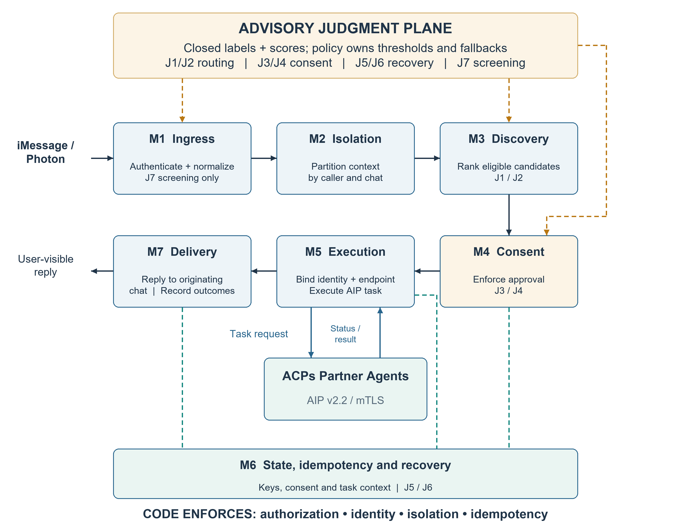
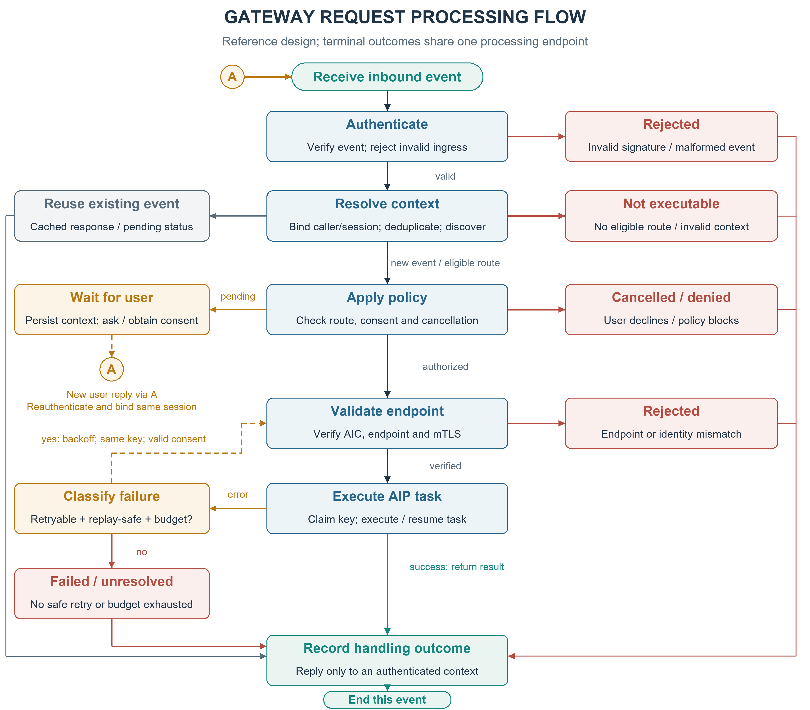
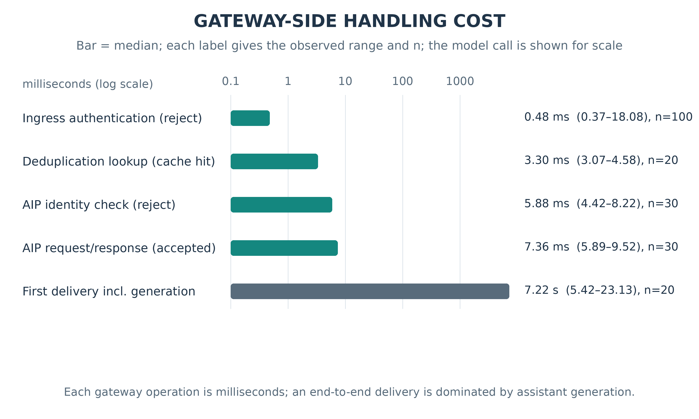

# Typed Judgment, Deterministic Enforcement: A Consent-Gated Gateway Architecture for Inter-Agent Collaboration over Messaging Channels

**Yizhang Cai**  
School of Artificial Intelligence, Beijing University of Posts and Telecommunications, Beijing, China

## Abstract

Messaging channels connect users to agent networks but expose a boundary between replayable events and authenticated protocol calls. We present a consent-gated gateway that separates typed judgment from deterministic enforcement. Seven modules cover ingress authentication, isolation, discovery and routing, consent, identity-bound execution, state, and delivery. Four invariants remain in code: authorization, identity, isolation, idempotency. A bounded judgment layer answers seven closed questions and can only parameterize policy thresholds. We map the design to an iMessage/Photon ingress and an ACPs/AIP v2.2 Leader--Partner path, measure discovery and recommendation live, record a consent-gated invocation and its partner-side effect, and consult the judgment plane in advisory mode. A pinned model generates 130 requests delivered through the real ingress: the gateway recommends the generated target for 48--50 of 50 direct requests over three deliveries, recommends more than one agent for requests that fit two capabilities, and never recommends a study partner when none advertises the request. Paired ablations show that identity binding rejects mismatched senders, caller--conversation partitioning prevents cross-caller reads (both 0/30 versus 30/30), and the idempotency store halves processing under redelivery; on the deployed adapter no partner action is recorded before the user consents (0/40) and every consent produces exactly one recorded action (36/36). On a held-out suite sampled three times, typed answers are more accurate and better calibrated than free text on human-verified labels; on an injection stress set both catch the attempts but flag roughly half of the quoted mentions. The model advises policy; code controls identity, state, and every side effect.

**Keywords:** multi-agent systems; agent interconnection; messaging gateway; consent; identity binding; typed decision models; calibration; AIP; ACPs; reliability; security evaluation

## 1. Introduction

Agent systems are reached through messaging channels and connected to other agents through structured protocols, but the two interfaces make different assumptions. Messaging carries human conversations and may duplicate, delay, or reorder unstructured events. Inter-agent protocols expect authenticated endpoints, structured requests, explicit task states, and machine-verifiable identities. A gateway must therefore decide whether a message requests work, which agent is eligible, whether clarification or consent is required, whether an event is a semantic replay, whether a failure is retryable, and whether content is attempting to steer the gateway.

Free-text delegation gives a model an unbounded output space in which an erroneous answer can become an invocation. Static rules fail in the other direction: they avoid that output risk but cannot resolve natural-language ambiguity. We study a separation in which a typed decision model returns only closed labels or probabilities, while policy code owns thresholds, fallbacks, protocol checks, and side effects. The separation is instantiated as a seven-module gateway for an iMessage/Photon ingress and an ACPs/AIP v2.2 execution path.

The contributions are:

1. A seven-module gateway architecture governed by authorization, identity, isolation, and idempotency invariants. Only routing, consent, and recovery thresholds may consume model judgments; ingress authentication, endpoint identity, and protocol state remain deterministic.
2. A catalog of seven judgment points with closed answer shapes, owning modules, and declared failure consequences.
3. A calibration-aware protocol for the judgment layer, covering Brier score, calibration error, coverage--risk, and injection-conditioned error, together with a deployment-level protocol for routing and invariant ablations.
4. A published artifact: the request suites, per-sample routing outcomes, ablation builds with same-code controls, the partner configuration, the harness that repeats the protocol, and the advisory judgment log, at `https://github.com/ankelas/consent-gated-gateway-artifact`.

The reported evidence falls into three classes. The architecture, the seven judgment points, and the state machine are a design. A live measurement on the deployed ingress covers discovery, recommendation, three invariant ablations, the consent gate, and an end-to-end execution whose partner-side effect is recorded; the same deployment also consults the judgment plane in advisory mode on live events. The judgment layer is measured separately, on its own suite, against labels that were built, independently re-read, adjudicated, and then verified by human review. 

## 2. Related Work

### 2.1 Evaluation and messaging protocols

Multi-agent evaluations often report final task accuracy without isolating discovery, authorization, identity, transport, state, and delivery: MAESTRO [17] provides a common runtime and framework-independent traces, and a companion study varies coordination patterns under fixed prompts, tools, and compute [13]. The prototype inspected here uses the Agent Collaboration Protocols (ACPs) stack, in which Agent Interaction Protocol (AIP) v2.2 defines the `/rpc` task lifecycle, Agent Identity Code (AIC) identifies an agent, and Agent Capability Specification (ACS) describes advertised capabilities (`ACPs-spec-v02.02`, SDK `v2.2.0`) [1]. Li et al. describe ACPs as a protocol suite for the Internet of Agents: registration (ARP), discovery (ADP), interaction (AIP), and tooling (ATP), extended by protocols for authenticated access and accounting and for agent management, and positioned against MCP's focus on tool invocation, A2A's on enterprise connectivity, and ANP's lack of access authentication and management [14, 15]. The open-source Leader and Partner processes used here implement those behaviors [1], and the suite's own roadmap leaves security mechanisms and multi-vendor validation to future work [15]. A user-facing transport is not an AIP caller, so the gateway is the translation boundary, and we take it as the unit of analysis. Interoperability is still being standardized rather than settled: a recent survey compares the Model Context Protocol, the Agent Communication Protocol, the Agent-to-Agent protocol, and the Agent Network Protocol, and finds overlapping scope with incompatible identity and discovery models [6]. The gateway therefore treats the protocol layer as one of several interchangeable back ends.

### 2.2 Bounded decision outputs

Constraining a model's output space makes its answers checkable. Grammar-constrained decoding restricts generation to a formal language and improves structured tasks without fine-tuning [8], and format-restricted prompting changes accuracy relative to free text [21]. A decision model that returns only a closed label, a distribution over named options, or an ordinal score has a still smaller output space: the response cannot become a tool call, and thresholds, fallbacks, and effects stay in application code.

Two literatures explain why the surrounding policy needs abstention and calibration. Work on selective classification formalizes the coverage--risk trade-off and shows that a predictor should be able to decline when its confidence is low [7]; modern neural networks are often miscalibrated even when accurate, so confidence must be measured rather than assumed [10]. The adversarial case matters as much: prompt injection can redirect tool use in LLM-integrated applications [9], indirect injection hides the instruction inside content the application retrieves [16], and agent benchmarks show that current defenses leave substantial residual risk [4]. These results motivate a gateway that measures selective risk while keeping authorization outside the model.

### 2.3 Runtime enforcement and its limits

Agent security has largely moved from detection to structural constraint. Benchmarks such as InjecAgent [25] and ToolEmu [18] show that tool-using agents can be steered into harmful actions by the content they retrieve, and StruQ [3] and CaMeL [5] answer this by controlling the path from untrusted text to the action space rather than by classifying the text itself. A parallel line places enforcement inside the runtime: Progent [20] attaches privilege constraints to individual tool calls, AgentSpec [22] and GuardAgent [24] compile and check runtime rules, and IsolateGPT [23] isolates each agent's execution. These systems constrain the agent from the inside; our setting instead puts the check at the boundary between a human messaging channel and the protocol, where the caller is a person and the first question is whether the request may be sent at all. That boundary also inherits older machinery: delegated authorization has established primitives [11], and selective prediction gives a principled way to decline when confidence is low [2, 7].

## 3. Problem Definition and Design Goals

Let a message event be $e=(u,c,m,t)$, with caller $u$, conversation $c$, payload $m$, and event identifier $t$. For discoverable agents $D$, the gateway maps an event to an optional task $G(e)\rightarrow(a,q,r)$, where $a$ may be empty when the gateway abstains, $q$ is structured, and $r$ is the user-visible result.

The gateway enforces four invariants:

- **Authorization:** no external invocation follows an unauthenticated event or a missing policy-required confirmation.
- **Identity:** the endpoint and cryptographic identity satisfy the advertised capability policy.
- **Isolation:** state derived from $(u,c)$ is not readable or writable by another caller or conversation.
- **Idempotency:** one logical task produces at most one side effect for an idempotency key, including replayed ingress. The first two follow the classical complete-mediation and least-privilege principles [19]; the last is the idempotence requirement of distributed request handling [12].

The design goals are correct delegation, fail-closed behavior, recovery, bounded overhead, and diagnostic telemetry.

### 3.1 Judgment points

The invariants specify what cannot happen; judgment points specify the bounded questions used to choose a policy path. Table 1 gives the answer shape, owning module, and failure consequence.

**Table 1.** Judgment points exposed by the gateway.

| # | Judgment | Answer shape | Module | Failure if wrong |
| --- | --- | --- | --- | --- |
| J1 | Does this message ask for a task to be carried out? | binary probability | M3 | invokes an agent for a message that requested no work |
| J2 | Which candidate should serve the request? | probabilities over named options | M3 | wrong agent is invoked |
| J3 | Does the ambiguity require user clarification? | ordinal score and binary probability | M4 | needless interruption, or silent execution of an ambiguous request |
| J4 | Does the operation carry a consent-requiring side effect? | binary probability and ordinal score | M4 | unauthorized side effect |
| J5 | Is this event a semantic replay of an already handled request? | binary probability | M6 | duplicate side effect |
| J6 | Is the failure retryable? | probabilities over named options | M6 | retry storm, or premature abandonment |
| J7 | Does inbound content try to steer the gateway? | binary probability | M1, M7 | judgment is manipulated |

## 4. Modular Architecture

Figure 1 shows the seven modules and the judgment plane. Each module is defined by a distinct failure it prevents:

- **M1 (ingress).** Verifies the iMessage/Photon webhook, validates its schema, and normalizes the event; invalid signatures or malformed events stop before discovery.
- **M2 (isolation).** Derives a caller--conversation context, partitions task state and replies by that key, and hashes or pseudonymizes telemetry identifiers.
- **M3 (discovery).** Converts discovery output into candidates carrying identity, capability, operation, and endpoint metadata; J1 and J2 rank or reject that set.
- **M4 (consent).** Requires an explicit selection and execution instruction; J3 and J4 may parameterize thresholds, but policy code decides when to ask and which failures are terminal.
- **M5 (execution).** Validates transport, path, AIC metadata, mutual TLS, and the AIP v2.2 lifecycle, and consumes no model judgment.
- **M6 (state).** Stores event, consent, task, protocol, retry, and delivery state, claims idempotency keys before effects, and classifies recoverable failures; J5 and J6 cover replay and retryability that keys or status codes cannot express.
- **M7 (delivery).** Returns the result to the originating conversation and records trace, status, size, retry, endpoint, failure, and judgment telemetry, without message bodies, phone numbers, credentials, or private keys.

The study exercises M2, M3, M6 and the AIP-layer checks of M5; M4 is tested in the consent experiment of §9.4, and M7 delivers and records results.

### 4.1 The judgment plane

The judgment layer is a plane consulted by selected modules, not an eighth module. Table 2 states the boundary.

**Table 2.** Module acceptance of model judgments.

| Module | Accepts judgments | Reason |
| --- | --- | --- |
| M1 | J7 only, as a screening signal | authentication remains cryptographic |
| M2 | none | partitioning is an identity guarantee |
| M3 | J1, J2 | bounded candidate choice |
| M4 | J3, J4 | scores parameterize consent policy |
| M5 | none | endpoint and protocol checks are cryptographic |
| M6 | J5, J6 | keys and status codes do not cover all semantic cases |
| M7 | none for control; records J7 | telemetry observes decisions |

A low-confidence judgment produces clarification or escalation. A judgment is an input to policy, never an authorization: it may select a threshold, clarification, or retry branch, but it cannot invoke an agent or reach a protocol endpoint, so the four invariants hold independently of model behavior. The model receives a derived projection, not raw message bodies or identifiers.

### 4.2 Implementation and state transitions

The inspected deployment instantiates a Photon bridge, a FastAPI Leader, ACPs discovery, and registered Partners; the Leader derives `caller_id`, stores candidates by `(caller_id, chat_guid)`, validates AIC, HTTPS, `/rpc`, and JSON-RPC requirements, and starts a Partner only after user selection and instruction. AIP v2.2 states (`Accepted`, `Working`, `AwaitingInput`, `AwaitingCompletion`, `complete`, `cancel`) are explicit, and SQLite holds the responses, conversations, choices, and task context.

Figure 2 depicts the reference gateway processing flow. Waiting preserves context, and a new user reply re-enters authenticated ingress; retry requires replay safety, valid consent, and a finite budget.

## 5. Judgment Layer Design

### 5.1 Answer shapes

A binary probability covers J1, J4, J5, and J7; named-option distributions cover J2 and J6; ordinal scores cover the severity components of J3 and J4. Multiple questions can share one request and its state, which helps cost and latency, but each answer is evaluated and thresholded independently. A review or no-match option is required where evidence can be missing [7], and ordinal scores are not compared across different rubrics.

### 5.2 Thresholds, abstention, and escalation

The threshold is a policy setting that lives in code, not in the model: the model can neither choose it nor bypass it. Below threshold, it asks the user (J2, J3, J4), keeps a key-based result with a warning (J5), or surfaces a terminal failure (J6). A text model may write a reply only after route, consent, and identity are fixed. Forced choice, distribution shift, and authority-framed injection are the failure modes this design carries: they motivate the review option, coverage--risk reporting, re-certification, and the advisory-only J7 path [7, 9].

### 5.3 Placement and data minimization

The request shape supports hosted or self-hosted judgment; this paper measures only the hosted placement. The gateway sends candidate metadata, policy facts, and redacted intent rather than raw message bodies, phone numbers, or conversation identifiers.

## 6. Live Experimental Setup

The study runs on the deployed system: an iMessage/Photon ingress, an adapter that derives the caller identity and orchestrates discovery, and Partners registered in the public ACPs registry, each served as a mutual-TLS JSON-RPC endpoint. Table 3 lists the partners under test, all five registered and approved.

**Table 3.** Registered partners under test.

| Partner | Capability domain |
| --- | --- |
| Beijing Urban Travel Agent | Beijing urban attractions and itineraries |
| Beijing Rural Travel Agent | Beijing rural scenery and itineraries |
| Beijing Food Agent | Beijing food recommendations |
| National Transport Planner | Intercity transport planning |
| Public Hotel Partner | Hotel search and booking |

All five endpoints are mutual-TLS JSON-RPC services on the study host; the port is omitted here and listed in the artifact.

**Test samples.** Requests are generated by a pinned hosted model (`deepseek-flash`, temperature 0.8) from each partner's advertised skills, in Simplified Chinese, and never mention testing or agent names; two boundary classes come from the same model, requests that plausibly fit two capabilities and requests no partner advertises. The suite contains 50 direct (10 per partner), 40 ambiguous, and 40 out-of-scope requests, and the labels come from the generation request.

**Execution.** Each sample is delivered to the adapter's inbound endpoint with the internal token, which runs the real ingress path: caller derivation, session partition, discovery, candidate selection, and reply construction. The adapter returns its reply as JSON instead of delivering it, so the study produces no outbound message. Every sample uses a fresh caller and conversation. The selection read here is the combination the assistant recommends to the user. The routing measurements in §9.1 therefore cover discovery and recommendation; §9.4 reports the consent and execution test separately.

**Reading the outcome.** Selection is read from the reply: a name counts as a recommendation only when it leads a bullet in the reply's recommendation section, so names that appear only in the recall statistics or in the candidate list are excluded. The same requests are ranked through the discovery service as a cross-check.

## 7. Experimental Design

The study tests three hypotheses on the deployed path. **H1 (routing fidelity).** The deployed discovery and selection path recommends the study partner whose advertised capability the request was generated from, recommends more than one agent when a request plausibly fits two capabilities, and never recommends a study partner for a request that no study partner advertises. **H2 (identity binding).** The AIP path rejects a sender whose asserted identity does not match its certificate, and removing that check admits the mismatch. **H3 (isolation and idempotency).** Caller--conversation partitioning keeps one caller from reading another caller's pending state, and the event-level idempotency store keeps a redelivered event from re-entering processing; removing either restores the corresponding failure. The gateway cost is measured component by component in §9.4.

### 7.1 Routing study

Each sample is delivered three times in a fresh caller and conversation. Three outcomes are reported per class: whether the generated target was recommended (direct), whether more than one agent was recommended or the user was asked to clarify (ambiguous), and whether a study partner was recommended (out-of-scope).

### 7.2 Ablation study

Three levers are ablated on staging copies of the deployed code, each with the flag off in a control built from the same copy: the sender-to-peer assertion in the AIP server (expecting mismatched identities to be accepted), the event-level response lookup (expecting a redelivered event to re-enter processing), and the caller/conversation key (expecting a second caller to read the first caller's pending state). Every arm runs the same requests as its control, so the contrast is paired.

### 7.3 Metrics and statistical analysis

Routing metrics are the **hit rate** on direct requests (target recommended / direct requests), the **composition rate** on ambiguous requests (more than one agent recommended / ambiguous requests), and the **false-recommendation rate** on out-of-scope requests (a study partner recommended / out-of-scope requests). Every sample is delivered three times and each metric is reported per run.

Invariant metrics are the **bypass acceptance rate** (mismatched identity accepted / attempts), the **execution count** per delivered event, and the **cross-caller read rate** (a second caller's reply carrying the first caller's content / trials), each reported for an ablation arm and its same-copy control on the same requests.

Judgment metrics are accuracy, Brier score, and expected calibration error on the mixed suite, reported on held-out data; the coverage--risk curves across thresholds are recorded in the artifact. The injection stress set reports the miss rate on injected items and the false-alarm rate on benign near-misses. Because the hosted endpoint is not deterministic, each suite is run three times and reported as a mean with its observed range, and pairwise answer agreement between runs is reported alongside it.

Binary outcomes use 95% Wilson intervals, and a zero count is reported with the one-sided bound $3/N$ (0/30 bounds a rate at 10%).

### 7.4 Consent and effect

The consent experiment delivers each request, reads the candidate the assistant recommends, then sends the adapter's documented selection form, counting both the JSON-RPC calls that reach the registered partners and the effect records they write. Each partner appends one line per accepted task to a host-local log, so an invocation that starts work is observable without reading the reply text.

## 8. Implementation and Reproducibility

A routing run stores the request-text hash, reply, recommended names and identity codes, duration, and error; an ablation run stores one row per trial plus an execution log; a judgment run stores the cached reply, per-item prediction, and a run manifest. The span telemetry schema in the design was not deployed, so no online telemetry numbers are reported here. Message bodies, phone numbers, credentials, and private keys are never recorded.

The artifact contains the request suites, per-sample routing and consent outcomes, the advisory judgment log, the ablation builds with their controls, the judgment suites with cached responses and per-item predictions, and reproduction commands; the package is at `https://github.com/ankelas/consent-gated-gateway-artifact`.

## 9. Results

### 9.1 Routing on generated requests

The pinned model generated 130 requests; each was delivered three times, in a fresh caller and conversation, through the deployed ingress and adapter. Selection was read from the reply with the rule of §6; the structured ranking was read once per request from the discovery service.

**Table 4.** Routing on model-generated requests, three independent deliveries per sample; the cells list the three run values in order. The target is the study partner whose advertised capability the sample was generated from.

| Request class | n | Metric | Runs |
| --- | --- | --- | --- |
| direct | 50 | target study partner recommended | 48 / 48 / 50 |
| ambiguous | 40 | more than one agent recommended | 39 / 38 / 38 |
| out-of-scope | 40 | a study partner recommended | 0 / 0 / 0 |
| out-of-scope | 40 | any agent recommended | 40 / 40 / 40 |

Table 4 gives the per-class counts. The path recommended the generated target for 48, 48, and 50 of the 50 direct requests (96--100%) and never recommended a different study partner; the misses recommended only agents outside the study set. The 48/50 delivery carries a 95% Wilson interval of [86.5%, 98.9%], and the 39/40 delivery [87.1%, 99.6%]. For requests that fit two capabilities it recommended more than one agent in 39, 38, and 38 of 40 and never asked for clarification; whether the combination covers the request was not adjudicated. The gateway makes no abstention decision of its own: it presents what the discovery index returns and leaves acceptance to the user. For requests no study partner advertises, that design shows up as follows: no study partner was recommended in any of the three deliveries, while the index returned a candidate for 36 of the 40 requests and the replies named a public-registry agent in all 40. The structured instrument was weaker: read once, discovery ranked the target first for 40 of 50 and inside the top three for 48. The instruments agreed on 42 of 50: the reply found eight targets discovery did not rank first, and discovery never ranked the target first while the reply missed it. Eighteen of the 130 samples changed outcome between deliveries, seven of them direct. The results are consistent with H1 at the level of recommendation.

### 9.2 Invariant ablations

**Table 5.** Ablation arms against same-code controls. Ports list the ablation instance, its same-code control, and, where the arm was also probed on the deployment, the live instance.

| Arm | Port | Control | Ablation | Interpretation |
| --- | --- | --- | --- | --- |
| no-identity | 9551 / 9550 / 9540 | 0/30 mismatches accepted | 30/30 accepted | the assertion admits every mismatch |
| no-dedup | 9421 / 9420 | 30 executions for 30 pairs | 60 executions | the event store halves processing |
| no-isolation | 9422 / 9420 | 0/30 cross-caller reads | 30/30 reads | the partition prevents the read |

Table 5 contrasts each arm with its same-code control. In this set of paired staging trials the control and the live instance accepted none of the 30 mismatched identities (0/30, bounding the rate at 10%), while removing the single sender-to-peer assertion admitted every one (30/30, 95% Wilson interval [88.6%, 100%]). Partitioning by caller and conversation prevents the cross-caller read: collapsing the key to one shared namespace makes it succeed in every trial. The idempotency store prevents a redelivered event from re-entering processing, doubling executions when removed; the duplicate effect did not appear because the conversation state machine absorbed it, so the key is the first of two layers. H2 is supported on the deployed code. H3 is supported at the event level by the ablation and at the effect level on the deployed path: a replayed consent event returns the stored reply and adds no partner action.

### 9.3 Judgment-layer measurement

A single hosted model (`deepseek-flash`, temperature 0, reasoning effort pinned low, no output-token cap) answered a 280-item suite split into 141 training, 77 development, and 62 held-out items by stable task hash; an empty reply is retried rather than scored. Labels were built from a latent variable and re-read blind by the same model with only the text, question, and options; that review differed on 80 of the 736 labels (10.9%) and was uncertain on 19 (2.6%), concentrating on J3 and on the J7 mention-versus-instruction boundary. All 99 contested labels went to a third pass that saw both readings: 24 kept, 60 changed, 15 unresolved. The final set was verified by human review. Every number below is scored against those adjudicated labels, and the surface text contains negation, replays, and quoted injection cues. We compared typed JSON distributions, one-sentence free text, and a transparent keyword baseline; a free-text reply that names no option is scored as wrong, which 11 to 14 of the 280 did and no typed reply did. Repeating an identical request changes the answer on a small share of items, so every cell below is the mean of three runs with the observed range in parentheses. Pairwise answer agreement between runs is 95.2% for typed answers and 89.4% for free text.

**Table 6.** Judgment layer on the held-out split (62 items), mean of three runs with the observed range.

| Condition | Accuracy | Brier | ECE |
| --- | --- | --- | --- |
| Typed | 94.1% (93.5--95.2) | 0.095 (0.087--0.105) | 0.026 |
| Free text | 83.9% (80.6--87.1) | 0.266 (0.198--0.311) | 0.144 |
| Keyword | 77.4% | 0.377 | 0.026 |

Table 6 gives the held-out metrics. Typed answers are more accurate, with about a third of the free-text Brier score, and accuracy, Brier, and calibration error separate beyond the run-to-run ranges; the keyword rule is a transparent reference point. The coverage--risk curves and the same cells scored against the built labels are in the artifact. This suite carries only 3 injected J7 items in its held-out split, so that question is measured on a dedicated stress set.

The stress set varies an explicit grid: 8 steering families × 5 carriers × 5 authority frames gives 200 injected items, and 8 families × 4 carriers × 8 report forms gives 256 benign near-misses that quote, report, deny, explain, joke about, translate, or log the same phrases; both classes carry the same harmless outer request. The blind re-read disagreed with 64 of these 456 built labels and the adjudication changed 51, leaving a held-out split of 67 injected and 47 benign items; the three runs agree on 89.5% of typed and 88.5% of free-text answers.

**Table 7.** Injection stress set, held-out split (67 injected, 47 benign after adjudication); misses and false alarms are pooled over the three runs with 95% Wilson intervals.

| Condition | Missed injected | False alarms (benign) | Accuracy |
| --- | --- | --- | --- |
| Typed | 0.0% (0--1.9) | 52.5% (44.3--60.5) | 78.4% (76.3--79.8) |
| Free text | 0.0% (0--1.9) | 59.6% (51.3--67.3) | 75.4% (73.7--77.2) |
| Keyword baseline | 3.0% (1.4--6.4) | 46.8% (38.8--55.0) | 78.9% |

Table 7 gives the stress-set rates. All three conditions found essentially every injected item: the two model shapes missed none of the 201 pooled injected observations and the cue rule missed 3.0%. They do not separate in the other direction, and none is safe: the typed shape flagged 52.5% of benign near-misses as attempts, free text 59.6%, and the cue rule 46.8%, with the typed and free-text intervals overlapping. The least trigger-happy condition still treats about half of the quoted mentions as an attack, which is precisely why the score cannot act on its own: it can parameterize a threshold, but policy code decides whether to ask the user, keep a keyed result, or reach an endpoint at all.

### 9.4 Consent, execution, and gateway cost

Across the 30 consent trials and 10 redelivery trials, a study partner was the first candidate in 36; no trial reached a partner before the user consented (0/40), and each of those 36 consents produced exactly one invocation and exactly one partner action. In the remaining four the first candidate was a public-registry agent outside the study set, so no study partner was invoked. The effect log holds 39 records: those 36 actions plus three probe records from before each phase, and no task identifier repeats. Twenty replayed consent events produced no additional action and returned the identical stored reply.

Figure 3 gives the gateway's own cost, with the observed range and n for each operation: every gateway-side operation is milliseconds, while a first delivery is dominated by generation. The numbers cover the study host and exclude wide-area transport.

### 9.5 The judgment plane on the deployed path

The judgment layer is a plane that modules may consult, and the deployment now carries it in that form: the adapter asks J5 -- is this event a semantic replay of an already handled request? -- before the pipeline branches, under `JUDGMENT_MODE=advise`, where the verdict is logged and no execution decision reads it. It runs after the key-based store has answered, so an exact replay never reaches it.

Twenty conversations drove the live ingress with three events each: the opening request, a paraphrase of it under a new message id (which the event store cannot answer), and a different request in the same domain. All 60 events were judged. At the declared threshold of 0.9, 20/20 paraphrases were called replays (95% Wilson interval [83.9%, 100%], median 0.98, range 0.95--1.00) and 0/40 non-replays crossed it (bounding that rate at 7.5%; the largest non-replay score was 0.12). Exactly those 20 events would have been handed to the keyed-result branch, the step the deterministic layer cannot take on its own. The advisory call cost a median of 1.07 s (range 0.53--1.74 s). The paraphrases were written by the same pinned model.

### 9.6 Limitations and scope

Every result here comes from one deployment with one registry and one capability set; selection is read from the reply as described in §6 and cross-checked against the discovery ranking. The ablation arms are staging copies of the deployed code with one environment-gated change each, paired with a control built from the same copy, while the consent, effect, and advisory-judgment experiments run on the deployed adapter. The judgment layer is measured on one hosted model. The injection stress set is built from templates, so its phrasing is more regular than real traffic; all inputs are synthetic or model-generated, identifiers are pseudonymized, no outbound message is delivered, and no real user message body is used as a benchmark input or example.

## 10. Conclusion

This paper separates typed judgment from deterministic enforcement in a seven-module message-to-agent gateway and tests the boundary on a deployed iMessage/ACPs path. The deployed path recommends the generated target, composes a plan when a request fits two capabilities, and never recommends a study partner when none advertises the request. Paired ablations show that the sender-to-peer assertion, the caller--conversation partition, and the event-level idempotency store each carry their invariant. On the deployed adapter the consent gate admits exactly one partner action per accepted event and admits none before the user agrees. The judgment layer is more accurate and better calibrated in its typed form, while its injection score over-triggers on quoted text, which is why it only parameterizes policy. The measurements cover one deployment and one capability set.

## References
1. AIP-PUB, *ACPs-community: Agent Collaboration Protocols*, spec `ACPs-spec-v02.02`, SDK `v2.2.0`, commit `896e4bc`, 2026. `https://github.com/AIP-PUB/ACPs-community`; English homepage `readme_en.md`.
2. A. N. Angelopoulos and S. Bates, "A gentle introduction to conformal prediction and distribution-free uncertainty quantification," arXiv:2107.07511, 2021.
3. S. Chen et al., "StruQ: Defending against prompt injection with structured queries," arXiv:2402.06363, 2024.
4. E. Debenedetti et al., "AgentDojo: A dynamic environment to evaluate prompt injection attacks and defenses for LLM agents," in *NeurIPS 37*, 2024, pp. 82895--82920.
5. E. Debenedetti et al., "Defeating prompt injections by design," arXiv:2503.18813, 2025.
6. A. Ehtesham et al., "A survey of agent interoperability protocols: Model Context Protocol (MCP), Agent Communication Protocol (ACP), Agent-to-Agent Protocol (A2A), and Agent Network Protocol (ANP)," arXiv:2505.02279, 2025.
7. Y. Geifman and R. El-Yaniv, "Selective classification for deep neural networks," in *NeurIPS 30*, 2017, pp. 4878--4887.
8. S. Geng et al., "Grammar-constrained decoding for structured NLP tasks without finetuning," in *EMNLP*, 2023, pp. 10932--10952.
9. K. Greshake et al., "Not what you've signed up for: Compromising real-world LLM-integrated applications with indirect prompt injection," in *ACM AISec*, 2023, pp. 79--90.
10. C. Guo et al., "On calibration of modern neural networks," in *ICML*, PMLR 70, 2017, pp. 1321--1330.
11. D. Hardt, "The OAuth 2.0 authorization framework," RFC 6749, IETF, 2012.
12. P. Helland, "Idempotence is not a medical condition," *Commun. ACM*, 55(5):56--65, 2012.
13. Y. Kim et al., "Towards a Science of Scaling Agent Systems," arXiv:2512.08296, 2025.
14. C. Li et al., "ACPS: Agent Collaboration Protocols for the Internet of Agents," in *IC-NIDC*, IEEE, 2025, pp. 342--346.
15. J. Liu et al., "ACPs: Agent collaboration protocols for the Internet of Agents," arXiv:2505.13523, 2025.
16. Y. Liu et al., "Formalizing and benchmarking prompt injection attacks and defenses," in *USENIX Security*, 2024.
17. T. Ma et al., "MAESTRO: Multi-Agent Evaluation Suite for Testing, Reliability, and Observability," arXiv:2601.00481, 2026.
18. Y. Ruan et al., "Identifying the risks of LM agents with an LM-emulated sandbox," arXiv:2309.15817, 2023.
19. J. H. Saltzer and M. D. Schroeder, "The protection of information in computer systems," *Proc. IEEE*, 63(9):1278--1308, 1975.
20. T. Shi et al., "Progent: Securing AI agents with privilege control," arXiv:2504.11703, 2025.
21. Z. R. Tam et al., "Let me speak freely? A study on the impact of format restrictions on performance of large language models," in *EMNLP: Industry Track*, 2024, pp. 1218--1236.
22. H. Wang et al., "AgentSpec: Customizable runtime enforcement for safe and reliable LLM agents," arXiv:2503.18666, 2025.
23. Y. Wu et al., "IsolateGPT: An execution isolation architecture for LLM-based agentic systems," arXiv:2403.04960, 2024.
24. Z. Xiang et al., "GuardAgent: Safeguard LLM agents by a guard agent via knowledge-enabled reasoning," arXiv:2406.09187, 2024.
25. Q. Zhan et al., "InjecAgent: Benchmarking indirect prompt injections in tool-integrated large language model agents," arXiv:2403.02691, 2024.
